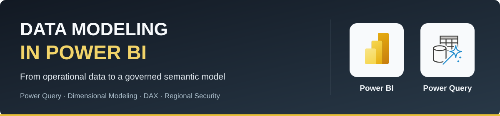
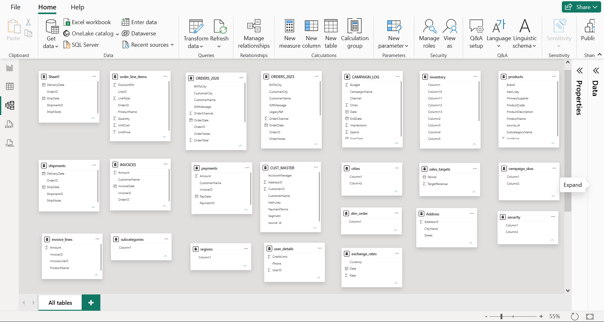
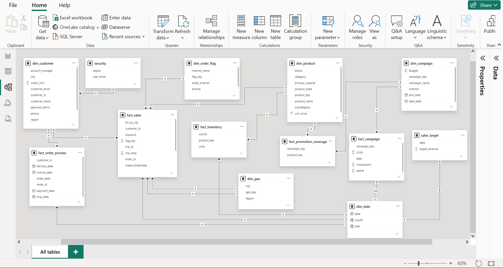

# 📊 Data Modeling in Power BI



[](#quick-overview) [](#quick-before-after) [](#quick-user-value) [](#quick-engineering) [](#quick-architecture) [](#quick-validation) [](#quick-skills) [](#quick-project)

## **A real-world Power BI data-modeling project based on challenges and solutions I have handled in professional BI work, recreated with simulated data.**

### **It demonstrates the same end-to-end approach I use to turn fragmented operational data into accurate reporting, scalable analysis, and secure regional access.**

<div align="center">


### From disconnected operational tables to a governed, analysis-ready dimensional model

**Reliable numbers · Faster report development · Reusable dimensions · Regional data security**

[Download the Power BI project](power-bi/Power_BI_Data_Modeling_Project.pbix) · [View the final model](power-bi/documentation/assets/power-bi-after-modeling.png)

</div>

---

<a id="quick-overview"></a>

## 🎯 Executive summary

| Business problem | Solution delivered | Business value |
|---|---|---|
| Sales, orders, invoices, inventory, campaigns, and customer data were fragmented across inconsistent source tables. | Audited, cleaned, merged, appended, reshaped, keyed, and validated the data before redesigning it as a governed dimensional model. | Users receive trusted metrics, analysts build reports faster, and BI teams gain a model that is easier to test, secure, maintain, and extend. |

### At a glance

| ⭐ Model | 📈 Analysis | 🔐 Governance | ✅ Quality |
|---|---|---|---|
| **6 dimensions** and **6 fact tables** | Sales, orders, inventory, campaigns, promotions, and targets | Dynamic regional row-level security | Grain, totals, cardinality, and filter paths validated |

---

<a id="quick-before-after"></a>

## 🔄 Transformation: before → after


### ❌ Before — disconnected source tables

Inconsistent names, duplicated entities, mixed grains, and no dependable relationship structure made reporting difficult to trust.

**Real Power BI model view**



### ✅ After — governed dimensional model

Reusable dimensions, clearly defined facts, one-to-many relationships, and controlled filter direction created a dependable semantic layer.

**Real Power BI model view**



[View the source and dimensional-model diagrams →](power-bi/documentation/README.md#quick-before-after)

---
<a id="quick-engineering"></a>

## 🛠️ Engineering work completed

Power Query transformations consolidated fragmented sources into conformed dimensions and analytical facts. The work included merge and append operations, unpivoting, surrogate keys, grain validation, reusable DAX measures, and dynamic regional security.

[Read the transformation and engineering details →](power-bi/documentation/README.md#quick-engineering)

<a id="quick-architecture"></a>

## 🏗️ Model architecture

Six shared dimensions and six fact tables support sales, order processes, inventory, campaigns, promotion coverage, and sales targets. Defined grains and controlled relationships support consistent analysis.

[Explore the dimensions, facts, and security design →](power-bi/documentation/README.md#quick-architecture)

---


<a id="quick-user-value"></a>

## 👥 How it helps users

| Audience | Outcome |
|---|---|
| **Business users** | Explore trusted sales, customer, product, inventory, campaign, and target metrics without understanding source-system complexity. |
| **Analysts & report developers** | Build visuals faster using friendly dimensions and reusable measures instead of rebuilding joins and calculations. |
| **Managers** | Compare actuals with targets and monitor the complete order-to-payment lifecycle from one model. |
| **BI & data teams** | Refresh, test, troubleshoot, secure, extend, and hand over the model more confidently. |

---
<a id="quick-validation"></a>

## ✅ Validation & governance

Validation covered fact grain, distinct orders, business totals, relationship cardinality, filter direction, and regional security.

[View the full validation checklist →](power-bi/documentation/README.md#quick-validation)

<a id="quick-skills"></a>

## 🧰 Skills demonstrated

| Area | Skills applied |
|---|---|
| Data modeling | Dimensional design, fact grain, surrogate keys, and relationship design |
| Transformation | Power Query merges, appends, unpivoting, and data-quality correction |
| Business logic | Reusable DAX measures and date modeling |
| Governance | Dynamic regional security, validation, and model optimization |

[See the complete skills breakdown →](power-bi/documentation/README.md#quick-skills)

---


<a id="quick-project"></a>

## 🚀 Explore the project

1. Download [`Power_BI_Data_Modeling_Project.pbix`](power-bi/Power_BI_Data_Modeling_Project.pbix).
2. Open it in **Power BI Desktop**.
3. Review the Power Query transformations, model relationships, measures, and security role.
4. Read the [technical documentation](power-bi/documentation/README.md) for the full implementation details.

```text
Data_Modeling-in-Power-BI/
├── power-bi/   # Completed PBIX project
│   └── documentation/
│       ├── README.md  # Detailed engineering and model documentation
│       └── assets/    # Screenshots, architecture diagrams, and banners
└── README.md
```

> The repository contains the completed Power BI file and model documentation. Original raw data files are intentionally excluded.
